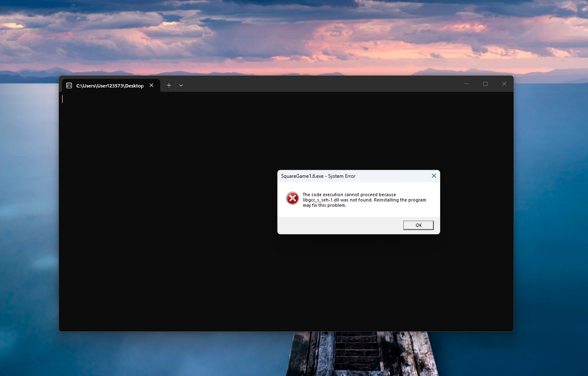

# Updates
Added Details to the game
# Made With
c++, Yaml
# Download Here
[Download at Releases](https://github.com/wolfdark1982-lgtm/SquareGame1.6C-Runtime/releases/tag/SG1.6)
# Versions
| **V1.6**  | [Click This Link](https://github.com/wolfdark1982-lgtm/SquareGame1.6C-Runtime) |

| **V1.5**  | [Click This Link](https://github.com/wolfdark1982-lgtm/SquareGame-1.5-C-Runtime) |

| **V1.4**  | [Click This Link](https://github.com/wolfdark1982-lgtm/SquareGame-1.4-C-Runtime) |

| **V1.3**  | [Click This Link](https://github.com/wolfdark1982-lgtm/SquareGame1.3C-Runtime) |

| **V1.2** | [Click This Link](https://github.com/wolfdark1982-lgtm/SquareGame1.2C-Runtime) |

| **V1.1** | [Click This Link](https://github.com/wolfdark1982-lgtm/SquareGame1.1C-Runtime) |

| **V1.0** | [Click This Link](https://github.com/wolfdark1982-lgtm/SquareGameC-Runtime) |
# Warning
if you see this

make sure c++ is installed and make sure raylib is installed and make sure yaml-cpp is installed

